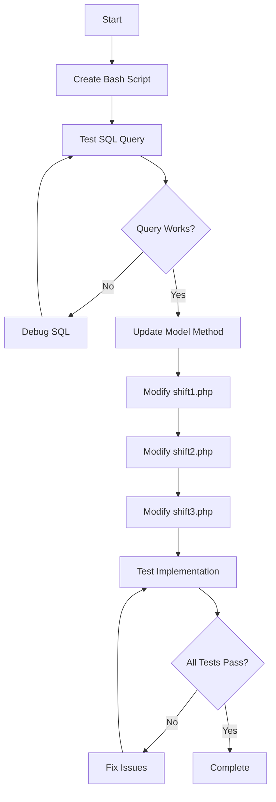
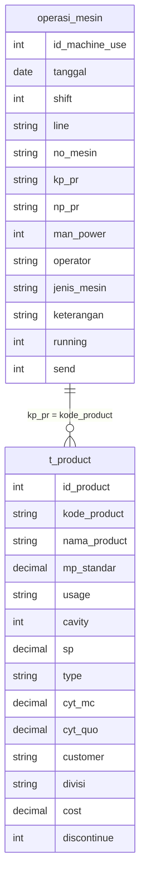
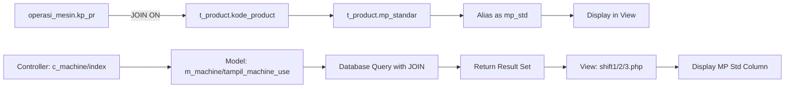

# MP Std Implementation Flowchart

## Process Flow

## Database Schema Relationship

## Data Flow Diagram

## Implementation Steps Detail

### Phase 1: SQL Validation
1. Create Bash script with MySQL client path
2. Test JOIN query between operasi_mesin and t_product
3. Verify mp_standar values are retrieved correctly
4. Confirm query performance is acceptable

### Phase 2: Backend Update
1. Modify `tampil_machine_use` method in `m_machine.php`
2. Add LEFT JOIN with t_product table
3. Select mp_standar field with alias
4. Maintain all existing functionality

### Phase 3: Frontend Update
1. Update shift1.php view file
2. Update shift2.php view file
3. Update shift3.php view file
4. Add column headers and data cells
5. Handle NULL values appropriately

### Phase 4: Testing
1. Test all three shift views
2. Verify data display accuracy
3. Check for PHP errors
4. Validate JavaScript functionality
5. Confirm responsive design works

## Key Technical Considerations

### Database Considerations
- Use LEFT JOIN to ensure all machine records appear
- Alias mp_standar as mp_std for consistency
- Handle NULL values gracefully
- Maintain query performance

### PHP Considerations
- Use isset() to check for NULL values
- Preserve existing array structure
- Maintain backward compatibility
- Follow CodeIgniter patterns

### Frontend Considerations
- Maintain table responsiveness
- Preserve existing styling
- Add proper column alignment
- Handle empty cells gracefully

## Risk Mitigation

### Potential Issues
1. **Query Performance**: JOIN might slow down large result sets
   - Mitigation: Test with realistic data volumes
   
2. **NULL Values**: Products without mp_standar might cause errors
   - Mitigation: Use isset() checks in views
   
3. **Breaking Changes**: Modifying core method might affect other functionality
   - Mitigation: Preserve all existing SELECT fields and conditions

### Rollback Plan
1. Keep backup of original m_machine.php
2. Version control for view files
3. Database backup before implementation
4. Clear rollback procedure documented

## Success Criteria

✅ SQL query executes without errors  
✅ MP Std values display correctly in all shifts  
✅ NULL values handled appropriately  
✅ Existing functionality preserved  
✅ No performance degradation  
✅ Responsive design maintained  
✅ No PHP or JavaScript errors